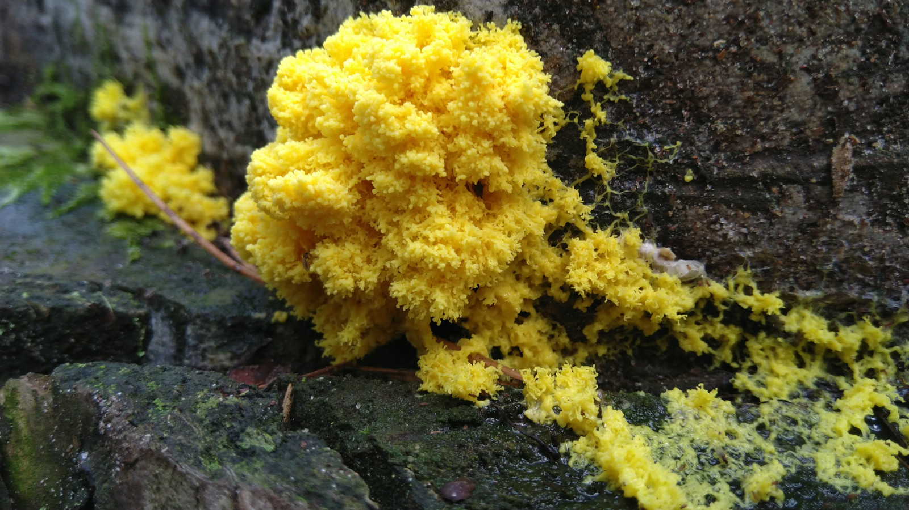

# Il fungo che risolve labirinti

Nonostante la stagione dei funghi stia finendo per far posto a quella delle lucine, voglio parlarvi di Physarum polycephalum. Più precisamente si tratta di un'ameba amante degli ambienti umidi e ombrosi.

La particolarità di questo simpatico grumo giallognolo è quella di saper risolvere in modo efficiente complessi labirinti. Il tutto senza un cervello! Ma non solo, Physarum polycephalum è in grado di riconoscere pattern e ricordare.

La prossima volta che vi perdete non pensateci troppo. Alla fine il cervello non è poi così importante per ritrovare la strada.

https://en.wikipedia.org/wiki/Physarum_polycephalum

