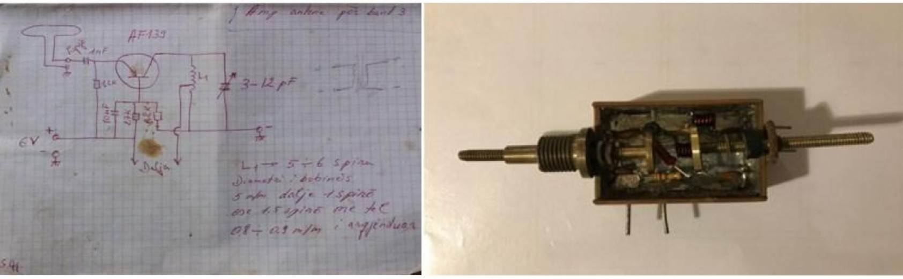

# Il ricevitore albanese per la TV italiana

L'Albania di Enver Hoxha (1944 - 1985) era il paese più isolato d'Europa:
autarchia, religione bandita, espatrio vietato. I televisori erano assemblati da
kit jugoslavi. Il regime chiuse le porte anche all'etere: ordinò di montare i
televisori senza il gruppo UHF, e guardare (o peggio commentare) un canale
straniero poteva costare anni di carcere.

Per guardare la Rai ci si procurava una kanoçe (lett. lattina): un convertitore
artigianale da UHF a VHF, in una scatoletta di lamiera grande come un pacchetto
di sigarette. Costava circa metà dello stipendio mensile di un operaio.

Grazie alla kanoçe gli albanesi videro il papa polacco, Solidarność,
la perestrojka, la fucilazione dei coniugi Ceaușescu e il crollo del Muro di
Berlino.

L'ironia? La volevano tutti, anche funzionari di partito e spie che ogni giorno 
ti mettevano in guardia contro il pericolo della cultura borghese.

[Testimonianza di Edison Ypi](https://memorie.al/ne-vitet-70-te-fillova-te-prodhoj-ne-seri-kanocet-ku-ishullaret-filluan-te-shikonin-lajme-filma-spektakle-etj-por-ato-i-kerkonin-edhe-komi/)
È in albanese ma nel 2026 tradurla non è un problema ;)
