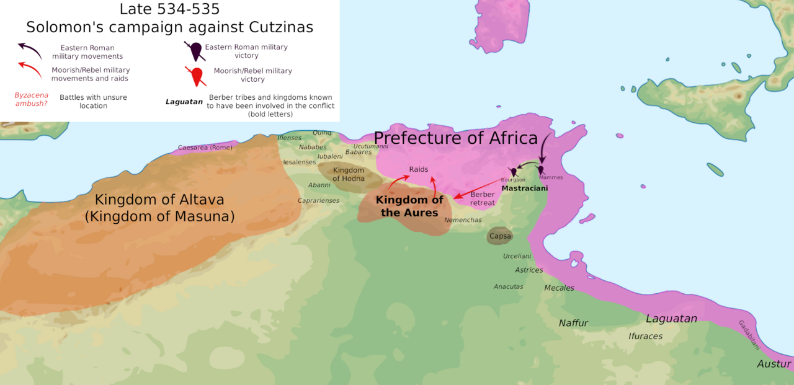

# Adam Smith e il prezzo degli schiavi

Chi mi conosce sa che amo citare (spesso a sproposito) il filosofo ed economista
Adam Smith (1723-1790). Ne "La ricchezza delle nazioni" egli spiega che, quando
al mercato arriva più merce di quanta i compratori siano disposti a pagare a
prezzo pieno, il resto va ceduto a chi offre meno, e quel prezzo basso trascina
giù tutto il mercato. Ovvero la "legge della domanda e dell'offerta".

Oltre 12 secoli prima Procopio di Cesarea racconta un caso da manuale. Nel 534
Giustiniano strappò il Nordafrica ai Vandali, ma le tribù mauri si ribellarono.
Nel 535 il generale Salomone le sconfisse al monte Bourgaon, nell'attuale
Tunisia. Dopo la battaglia vittoriosa, Salomone ritornò a Cartagine col suo
bottino di guerra. Sognava di arricchirsi ma forse non aveva ancora letto il
libro di Smith. Infatti, donne e bambini catturati furono così tanti che il
prezzo degli schiavi crollò e, narra Procopio, un ragazzo catturato era
valutato quanto una pecora.

[Procopio, Guerre IV.12](https://www.gutenberg.org/ebooks/16765)

