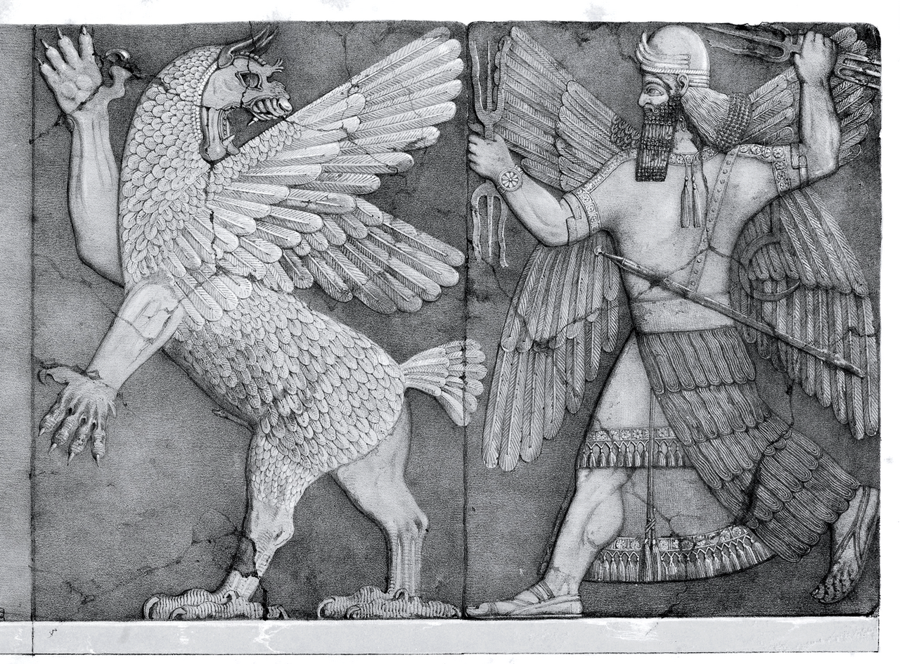

# Il dibattito tra pecora e grano

Mito di creazione sumero, scritto su tavolette di argilla tra la metà e la fine del III millennio a.C.
Descrive la nascita di Ashnan, dea del grano, e Uttu, dea della filatura della lana.
Prima che queste dee fossero generate, l'umanità viveva come le bestie:
"non sapeva mangiare il pane, non sapeva coprirsi con i vestiti, andava a quattro
zampe mangiando erba con la bocca e beveva acqua dai fossi".

Un giorno Ashnan e Uttu si ubriacano a un banchetto. Si assiste allora a un acceso
dibattito tra le due dee su chi sia la più importante per gli uomini.
In breve si arriva agli insulti con Pecora che accusa Grano di finire mangiata.
Nonostante Grano sia ferita nell'orgoglio, l'intervento di Enki (o Ea),
dio della sapienza, pone fine alla lite dichiarando il Grano superiore alla Pecora.

Insomma, la prima lite da ubriachi della storia. E non è finita nemmeno con un giro di amari.

[Traduzione in inglese del dibattito](https://etcsl.orinst.ox.ac.uk/section5/tr532.htm)
