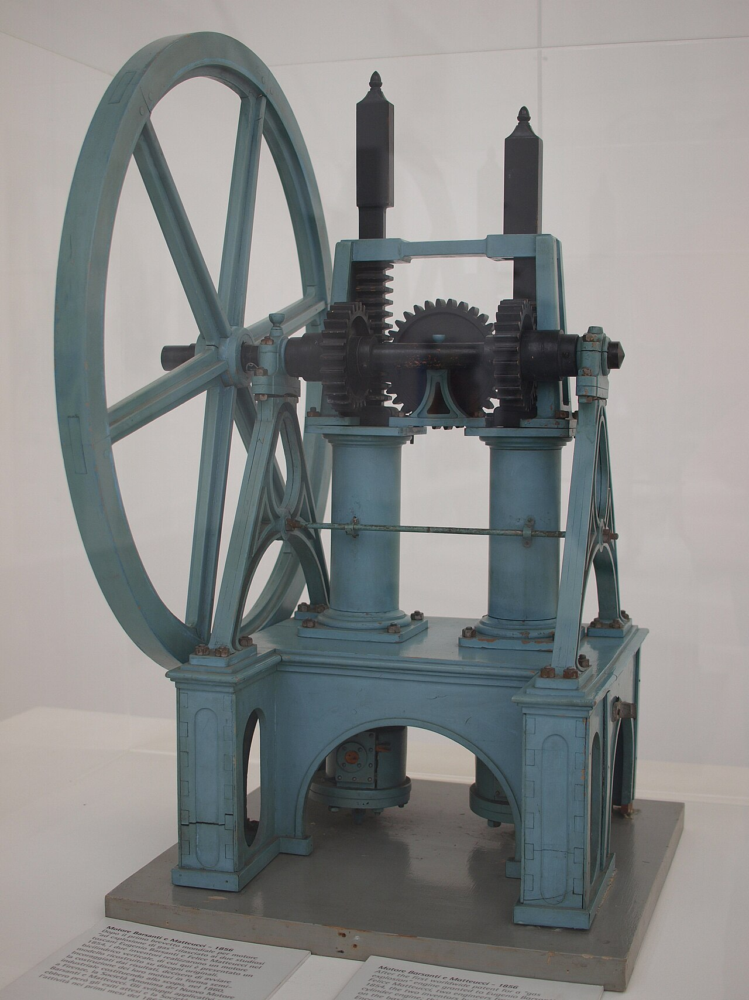

# Il primo motore a scoppio

Dietro l'invenzione del motore a scoppio c'è una storia italiana poco nota.
A metà dell'Ottocento, Eugenio Barsanti e Felice Matteucci realizzarono uno dei primi motori a combustione interna.

Funzionava in tre fasi:

1. Aspirazione: una miscela di aria e combustibile entrava nel cilindro.
2. Scoppio: una scintilla incendiava la miscela, spingendo il pistone verso
   l'alto.
3. Ritorno: i gas si raffreddavano e la pressione atmosferica, insieme al peso
   del pistone stesso, lo spingevano nuovamente verso il basso, azionando il
   volano.

Mancava completamente la fase di compressione. Questo impediva di sfruttare la
spinta della combustione per produrre lavoro: era la sola discesa, favorita
dalla pressione atmosferica, a generare il movimento.

Dai consumi riportati sulla [Treccani](https://www.treccani.it/enciclopedia/eugenio-barsanti_%28Dizionario-Biografico%29), ho calcolato un rendimento circa del 24% contro il 35-40% dei moderni motori a benzina. Pensavo peggio.

Guardate il [video dell Istituto Luce sul centernario](https://www.youtube.com/watch?v=CGDjKV4K1Fs). Merita.

[La storia dell'invenzione](https://barsantiematteucci.it/la-storia-dellinvenzione/)

