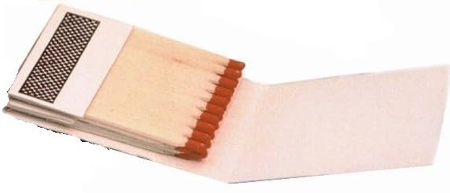

# Perché «pometki»

In russo, pometki (поме́тки) sono i segni che si lasciano su ciò che si legge: una sottolineatura, una crocetta, una parola a margine. La parola viene dal verbo pometit’ (поме́тить), «segnare, contrassegnare».

Questa rubrica nasce così: ogni settimana una cosa curiosa incontrata leggendo, segnata al volo e poi raccontata con le sue fonti.

Il gesto non è nuovo. Per oltre trent’anni Umberto Eco ha firmato sull’Espresso «La Bustina di Minerva», che prendeva il nome dalle bustine di fiammiferi Minerva: sul cartoncino interno, quando era libero dalla pubblicità, si appuntavano idee vaganti. Nella prima puntata, nel 1985, Eco distingueva chi si ferma agli appunti da chi poi li ricompone in un discorso.

Qui si prova a fare il secondo passo, una pometka alla volta.

[La prima Bustina di Minerva, ripubblicata dall’Espresso](https://lespresso.it/c/cultura/2016/2/26/umberto-eco-che-bellerrore-ecco-la-sua-prima-storica-bustina-di-minerva/19016)
