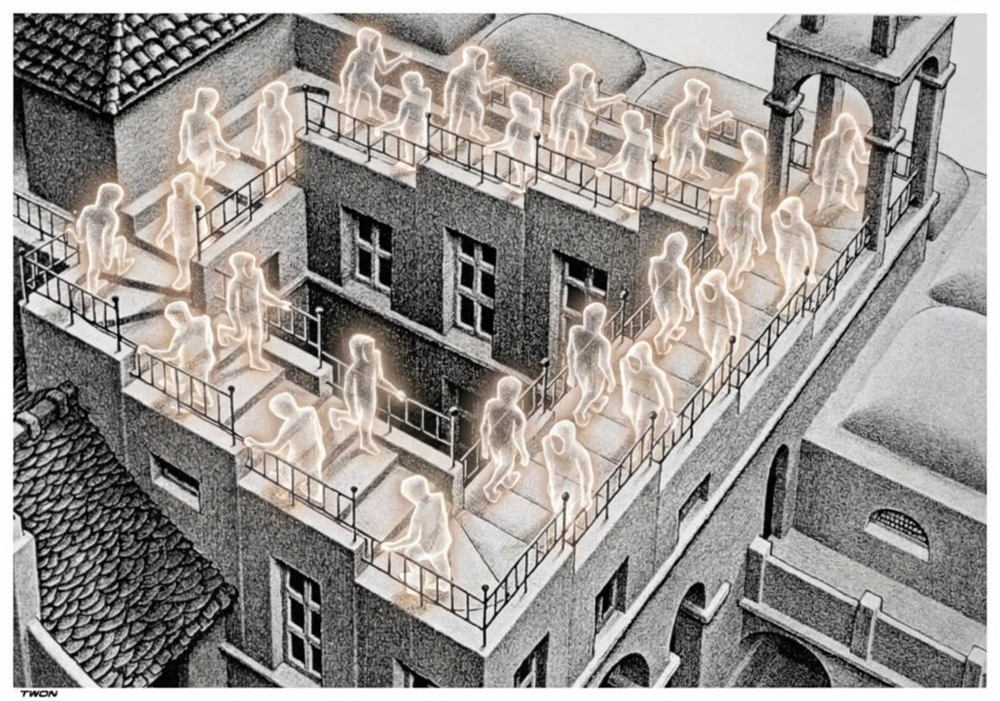

# Treppenwitz

Parola tedesca intraducibile se non con una perifrasi. Letteralmente vuol dire
"lo spirito delle scale". Non si tratta di uno spettro che alberga nelle vostre
scalinate, bensì con spirito si intende più propriamente una battuta sagace o
una risposta acuta che ci viene in mente solo in un secondo momento, quando si è
ormai "sulla scala", cioè quando è troppo tardi per usarla.

È un calco dell'espressione francese "esprit de l'escalier" coniata
nientepopodimeno da Denis Diderot, illuminista arguto ma non per questo immune
dal realizzare troppo tardi come rispondere ai suoi avversari. Forse vi
ricorderete di lui perché ha redatto assieme a d'Alembert la prima enciclopedia.

Un modo di dire simile c'è anche in cinese: "马后炮" (mǎhòu pào) sparare dopo
che il cavallo è passato. A quanto pare, solo in italiano non esiste un analogo.
Però noi abbiamo petaloso! Fun fact nel fun fact: petaloso esisteva già in
latino, fu usato nel 1695 dal botanico inglese, James Petiver.

[Esprit de l'escalier su Wikipedia](https://it.wikipedia.org/wiki/Esprit_de_l%27escalier)
