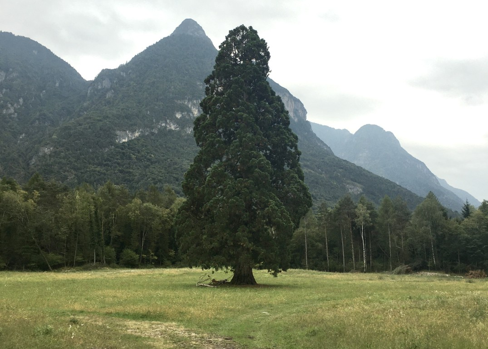

# La classifica dei miei alberi preferiti

## Al terzo posto

[Matusalemme](https://it.wikipedia.org/wiki/Matusalemme_%28albero%29), un Pinus longaeva di 4858 anni, in un luogo segreto. Bravo, eh, una veneranda età, ma che è longevo lo dice anche il nome.

## Al secondo posto

[Thimmamma Marrimanu](https://en.wikipedia.org/wiki/Thimmamma_Marrimanu), un baniano indiano con una chioma di quasi 2 ettari, nato, dice la leggenda, dal palo della pira funebre di una vedova. È un "fico strangolatore": pratica lo shibari da prima che fosse di moda, legando l’ospite con le radici aeree e stringendolo per secoli.

## Al primo posto

La [sequoia gigante di Longarone](https://it.wikipedia.org/wiki/Sequoia_gigante_di_Longarone), sopravvissuta al Vajont: porta ancora la ferita lasciata da acqua e fango.
Al primo posto perchè puoi essere vecchio, enorme e leggendario, ma vuoi 
mettere sopravvivere a una massa d'acqua con un'energia stimata di 60-90 TJ?
Più o meno quanto la bomba di Hiroshima (circa 63 TJ).

Se volete nerdare ulterirormente riguardo agli alberi consiglio di dare un'occhiata alla [Guida degli alberi monumentali d'Italia](https://web.archive.org/web/20250908144356/https://www.masaf.gov.it/flex/cm/pages/ServeAttachment.php/L/IT/D/2%2F3%2F2%2FD.3d644b25b10481c73308/P/BLOB%3AID%3D13577/E/pdf?mode=download).
