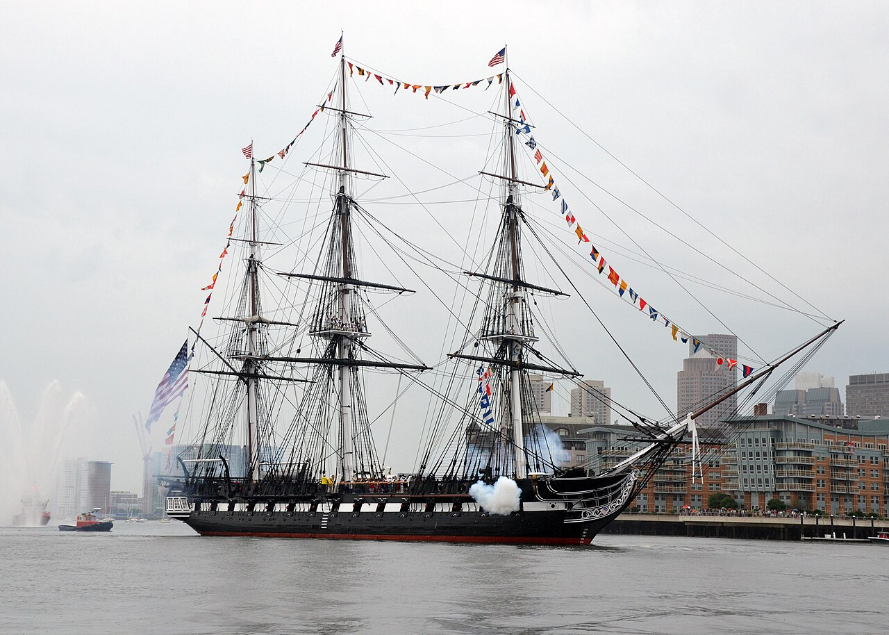

# La nave di Teseo

Racconta il biografo greco Plutarco che gli ateniesi conservarono nel porto la
nave con cui il mitico eroe Teseo era tornato da Creta, dopo aver sconfitto il
Minotauro e portato in salvo i giovani ateniesi destinati al sacrificio.

Nel corso degli anni, le assi di legno che marcivano venivano progressivamente
sostituite. Quando tutte le parti originarie erano ormai state rimpiazzate, i
filosofi iniziarono a interrogarsi se la nave fosse ancora "la nave di Teseo"
oppure no.

Questo paradosso affascinò anche Hobbes nel 17o secolo che lo estese, supponendo
che con le parti rimosse fosse costruita una seconda nave, anch'essa identica
alla precedente. Ora quale sarebbe la vera nave? Se scegliamo quella con il
legno originale, allora la materia determina l'identità dell'oggetto, altrimenti
è la forma.

Non è solo un dilemma filosofico. Si stima che circa l'8% della
[USS Constitution](https://it.wikipedia.org/wiki/USS_Constitution) (in foto) 
siano parti originali del 1797. Voi quale nave scegliereste? Avete una vostra
piccola nave di Teseo?
